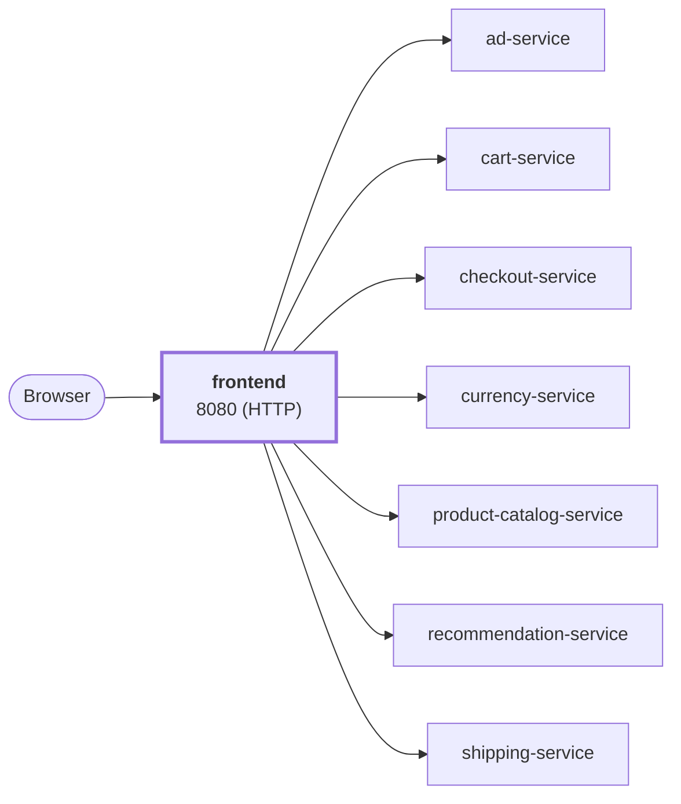

# frontend

website · platform-demo

The HTTP web storefront for the platform-demo e-commerce platform. It serves server-rendered HTML pages and static assets, keeps a session cookie per visitor, and fans out to seven backend gRPC services to build every page. It is the **only** component users (and ingress) talk to directly; everything else is internal.

Runtime<strong>Go 1.25</strong><small>Go</small>

Listens on<strong>8080</strong><small>HTTP</small>

State<strong>Stateless</strong>

Image<strong>frontend</strong><small>mladenovskistefan/</small>

## Where it sits

Browsers talk to the storefront only; it fans out to the backends below. It calls `ad-service`, `cart-service`, `checkout-service`, `currency-service`, `product-catalog-service`, `recommendation-service`, `shipping-service`.

## At a glance

| | |
|---|---|
| **Language / runtime** | Go 1.26 (`gorilla/mux`, `html/template`), static binary |
| **Image** | `mladenovskistefan/frontend` |
| **Protocol / port** | HTTP/1.1 on `8080` |
| **Metrics** | Pushed over OTLP/gRPC (Prometheus registry bridged into OpenTelemetry); `/metrics` on `9464` is still served for debugging |
| **Health** | `GET /_healthz` → `200 ok` — static, no dependency checks |
| **State** | None server-side; session id lives in a browser cookie, carts live in `cart-service` |
| **Depends on (gRPC)** | `product-catalog-service`, `currency-service`, `cart-service`, `recommendation-service`, `checkout-service`, `shipping-service`, `ad-service` |
| **Called by** | Browsers / ingress / load generators |
| **Not used** | `payment-service` and `email-service` are only reached via `checkout-service`. `shopping-assistant-service` is **not** wired in |

## Find it elsewhere

<h4><a href="https://argocd.platform-demo.test/applications/argocd/dev-frontend">Argo CD</a></h4>
Sync and health of <code>dev-frontend</code>.

<h4><a href="https://grafana.platform-demo.test/d/frontend-overview">Grafana</a></h4>
Latency, traffic and errors (<code>frontend-overview</code>).

<h4><a href="https://github.com/platform-boutique/app-frontend">Repository</a></h4>
Source, pull requests and releases of <code>app-frontend</code>.

!!! info "Part of the platform-demo platform"
    Cross-cutting facts (service wiring, observability contract, Kubernetes translation, CI/CD) are in the
    [master reference](https://github.com/platform-boutique/platform-demo-docs). This site only describes frontend.
